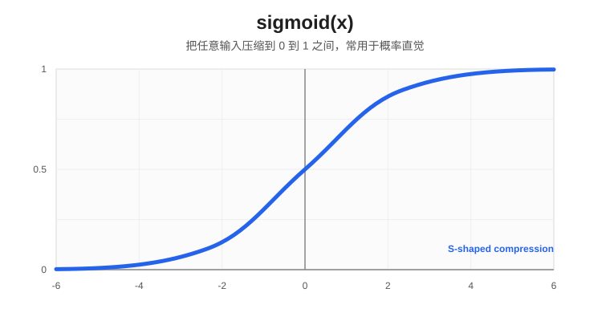
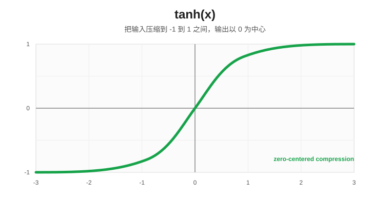
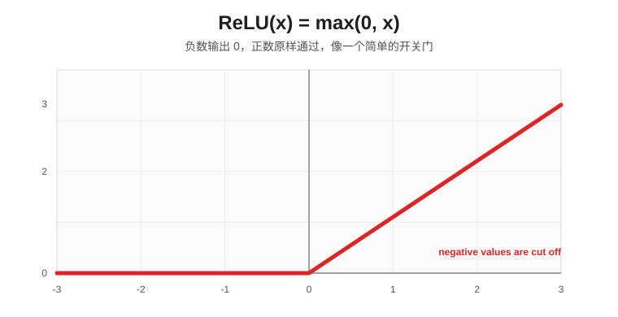
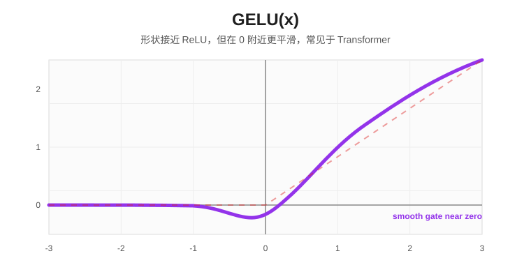

# 神经网络基础

> **更新时间**：2026-07-29
>
> **事实审校**：核心定义、公式与架构描述已按本章参考资料复核；实现细节以本次更新时间为边界。

神经网络是一类参数化函数。它由许多层组成，每层对输入做变换，最终得到预测结果。训练神经网络，就是调整这些层中的参数，让模型输出更接近目标。

## 人是怎么想到用神经网络做 AI 的

神经网络的起点来自一个朴素观察：人脑能学习，而人脑由大量神经元连接组成。人不是靠手写规则识别猫、理解语言或做判断，而是在大量经验中逐渐形成稳定的反应模式。早期研究者由此提出一个问题：能不能做一个数学版的神经元网络，让机器也通过调整连接强弱来学习？

这并不是说人工神经网络等同于真实大脑。真实神经系统极其复杂，包含生物电信号、化学递质、不同类型的细胞和动态反馈机制。人工神经网络只抽取了其中最重要的工程直觉：大量简单单元连接在一起，每个连接有强弱，系统可以通过经验调整这些连接。

一个人工神经元可以被简化成一个数学函数：

```text
输出 = 激活函数(w1*x1 + w2*x2 + w3*x3 + b)
```

其中 `x` 是输入，`w` 是权重，`b` 是偏置。权重可以理解为连接强度。训练的过程，就是不断调整这些权重，让模型输出越来越接近目标。

单个神经元能力有限，只能表达很简单的模式。但如果把很多神经元分层连接起来，前一层学习简单模式，后一层组合这些模式，就能表达更复杂的关系。例如图像模型中，底层可能学习边缘、颜色和纹理，中层学习眼睛、轮廓和局部结构，高层再组合出“猫”“人脸”“汽车”这样的对象。

这个思路和早期规则 AI 很不一样。规则 AI 试图让人把知识写成明确规则，例如“如果句子里出现退款，就进入售后流程”。这种方式在规则清楚的问题上有效，比如棋类搜索、专家系统、编译器和部分业务流程。但现实世界里有大量模糊问题：这张图是不是猫？这句话是不是讽刺？这段代码有没有 bug？这个用户下一步可能想买什么？这些问题很难靠人手写完整规则。

神经网络的吸引力在于，它不要求人显式写出所有规则，而是让模型从样本中学习规律。开发者定义模型结构、损失函数和训练方法，模型通过数据自动调整参数。换句话说，规则不再全部写在程序里，而是部分存储在训练后的参数中。

神经网络的想法很早就出现了，但很长时间内没能实用。让它变得实用的，是几个条件同时成熟：互联网带来了大量数据，GPU 适合大规模矩阵计算，反向传播、优化器、激活函数、归一化等算法技巧逐步成熟，PyTorch 和 TensorFlow 这样的工程框架降低了训练门槛。

大脑提供了”大量简单单元连接，通过经验学习”的启发；这种启发被转化成可计算、可训练、可扩展的数学系统，神经网络才算真正成功。

## 从线性模型到神经网络

最简单的模型可以是线性函数：

$$
y = Wx + b
$$

其中 `x` 是输入，`W` 是权重，`b` 是偏置。线性模型简单、可解释，但表达力有限。许多真实问题不是线性的。例如图片中的边缘、纹理、形状，语言中的语义和上下文，都难以用单个线性变换描述。

神经网络在多层线性变换之间加入非线性激活函数。没有激活函数时，多层线性变换仍然可以合并为一个线性变换。非线性让网络能表达更复杂的关系。

可以用房价预测理解线性模型：面积越大价格越高、离地铁越近价格越高。这些关系近似线性。但如果加入“学区”“楼龄”“城市核心区”等因素，价格变化可能出现明显非线性。例如 89 平和 91 平的房子可能因为政策分档价格差异很大。神经网络的多层非线性更擅长表达这类关系。

更直观地说，线性模型像一把直尺。它可以描述“越大越贵”“越近越好”这类大致单调的关系，但很难描述突然转弯、分段变化和多个条件共同触发的关系。现实问题更像一张弯曲的地形图：有山峰、山谷、平台和断崖。神经网络通过多层变换和非线性激活，把许多简单变换组合起来，近似这张复杂地形图。

这也是“深度学习”这个名字的来源。当神经网络只有一两层时，它表达能力有限；当网络堆叠很多层时，每一层都在上一层结果上继续加工，模型就能形成更抽象的表示。深度不是一个严格边界，通常只是表示网络有多层隐藏层。使用这类深层神经网络的方法，就被称为深度学习。

## 一个神经元在做什么

上一节的线性模型只能做一次加权组合。要构造能分层学习复杂模式的网络，需要先有一个可以反复连接、既能汇总输入又能引入非线性的最小计算单元。神经元就是这个工程积木。

一个神经元接收多个输入，对它们加权求和，再加上偏置，最后经过激活函数。权重表示某个输入对结果的重要程度，偏置控制整体平移，激活函数决定输出的非线性形态。

激活函数可以理解为神经元输出前的“转换规则”。神经元先把输入按权重加起来，得到一个原始分数；激活函数再决定这个分数应该怎样变成下一层可以继续使用的信号。它通常不包含需要训练的参数，而是一个固定的数学函数，例如“负数变成 0，正数保留”或“把任意数压缩到 0 到 1 之间”。

它之所以叫“激活”，来自神经元类比。早期人工神经网络借鉴了生物神经元的直觉：一个神经元接收到很多输入信号，如果综合刺激足够强，它就会被激活，并把信号继续传给后面的神经元；如果刺激不够强，它就基本不响应。人工神经元里的激活函数也是类似角色：加权求和得到原始分数后，激活函数决定这个神经元是否明显响应，以及响应强度有多大。

它的核心用途有两个。第一，给网络加入非线性。只有线性加权求和时，网络再深也只是一个线性模型，很难表达现实中的弯曲边界、条件触发和复杂组合。第二，控制信号的形态。不同激活函数会改变数值范围、梯度大小和“某个神经元是否被明显点亮”的方式，从而影响模型能学什么、训练是否稳定。

可以把它想成一道门：加权求和先判断当前输入中某种模式有多强，激活函数再决定这道门打开多少。门完全关闭时，输出接近 0；门打开时，信号继续传给后面的层。这样一来，后续层就能组合“边缘出现了”“某个词义线索出现了”“某个局部结构很强”这类中间信号。

常见激活函数包括 sigmoid、tanh、ReLU、GELU。现代深度网络中，ReLU 和 GELU 更常见，因为它们在训练深层网络时更稳定。

可以用一个简表建立选择直觉：

| 激活函数 | 常见场景 | 注意事项 |
|---|---|---|
| ReLU | 普通隐藏层的常见默认选择 | 负数区间输出 0，可能出现部分神经元长期不激活 |
| GELU | Transformer 和现代大模型 | 更平滑，计算略复杂 |
| sigmoid | 二分类输出层或概率直觉 | 深层隐藏层中容易梯度变小 |
| tanh | 需要正负输出范围的场景 | 深层网络中也容易梯度变小 |

单个神经元能力有限，但大量神经元组成层，多层再组合起来，就可以构造复杂函数。

把神经元想成一个可调旋钮也有帮助。某个旋钮可能负责“图片里是否有竖线”，另一个负责“是否有圆形边缘”。单个旋钮意义有限，但成千上万个旋钮组合起来，就能从像素中逐步形成“轮子”“车窗”“汽车”这样的概念。

这个作用可以从一个反例看得更清楚。假设一层只做 `Wx + b`，下一层也只做 `W2x + b2`，无论叠多少层，整体仍然可以合并成一个更大的线性函数。就像把很多透明玻璃叠在一起，看到的世界仍然没有发生复杂变形。激活函数相当于在每层之间加入非线性“滤镜”，让网络不再只是直线叠直线。

以 ReLU 为例，它的规则非常简单：

```text
输入 -3 -> 输出 0
输入 -1 -> 输出 0
输入  0 -> 输出 0
输入  2 -> 输出 2
输入  5 -> 输出 5
```

ReLU 像一个只允许正信号通过的门。负数被截断为 0，正数原样通过。这个操作看起来粗糙，却能让网络表达“某个模式出现时才激活，没出现时保持沉默”的行为。GELU 可以看作更平滑的门，常见于 Transformer 等现代模型中。

sigmoid 和 tanh 在早期网络中更常见。sigmoid 会把数压到 0 到 1 之间，适合表示概率直觉；tanh 会把数压到 -1 到 1 之间。但在很深的网络里，它们容易让梯度变得很小，训练会变慢，所以现代大模型更常使用 ReLU、GELU 或它们的变体。

下面几张图把常见激活函数分开画出。这样更容易看清它们对输入数值做了什么变换。









从图上可以看到，sigmoid 和 tanh 会把输入压缩到有限范围内；ReLU 在负数一侧直接输出 0，在正数一侧保持线性增长；GELU 的形状接近 ReLU，但在 0 附近过渡更平滑。

## 前向传播

模型文件里保存的参数本身不会产生答案。收到一张图片或一组特征后，系统必须按网络结构把输入依次送过各层，才能把这些参数变成一次具体预测。这个“从输入算到输出”的过程就是前向传播。

前向传播是输入从第一层流向最后一层的过程。每层接收上一层输出，计算新的表示。对于分类任务，最后一层通常输出每个类别的分数；对于语言模型，最后一层输出下一个 token 的概率分布。

看一个极简数值例子。假设我们用两个特征判断一条评论是否偏正面：

```text
x1 = 0.8  表示正向词比例较高
x2 = 0.2  表示负向词比例较低
```

第一层有两个神经元：

```text
h1 = ReLU(1.0*x1 + 0.5*x2 - 0.3)
   = ReLU(1.0*0.8 + 0.5*0.2 - 0.3)
   = ReLU(0.6)
   = 0.6

h2 = ReLU(-0.4*x1 + 1.2*x2 + 0.1)
   = ReLU(-0.4*0.8 + 1.2*0.2 + 0.1)
   = ReLU(0.02)
   = 0.02
```

第二层把这两个中间结果合成一个分数：

```text
score = 2.0*h1 - 1.0*h2 + 0.1
      = 2.0*0.6 - 1.0*0.02 + 0.1
      = 1.28
```

如果把这个分数送进 sigmoid，可能得到接近 0.78 的概率，表示模型认为这条评论偏正面的可能性较高。这个例子很小，但它展示了神经网络的基本形态：输入先被变成中间表示，再由后续层继续组合，最后输出任务需要的结果。

把这个两层网络画成数据流，就是：

```text
x1 ─┬─> h1 = ReLU(...)
    │          ┐
x2 ─┴─> h2 = ReLU(...) ──> score ──> sigmoid ──> 概率
```

真实网络只是把这个结构扩展到更多输入、更多神经元和更多层。

深度学习框架会把大量样本组成 batch 一起计算。这样可以把运算转换为矩阵乘法，充分利用 GPU 的并行能力。GPU 并不是因为“懂 AI”才适合训练，而是因为神经网络中大量计算可以被表示为高吞吐矩阵运算。

例如一次训练 32 张图片时，模型不是一张一张串行处理，而是把它们组成一个 batch。输入张量可能形如 `[32, 3, 224, 224]`，分别表示 32 张图片、3 个颜色通道、224x224 尺寸。GPU 可以并行完成这些矩阵和张量计算。

## 损失函数与反向传播

模型给出错误预测后，训练必须回答两个问题：到底错了多少，以及成千上万个参数分别应该向哪个方向调整。前一个问题由损失函数回答，后一个问题由反向传播回答。

模型预测和真实标签之间的差距由损失函数衡量。分类任务常用交叉熵，回归任务常用均方误差。损失越小，说明模型在当前数据上的预测越接近目标。

反向传播负责计算每个参数对损失的影响，也就是梯度。梯度告诉我们，如果稍微改变某个参数，损失会如何变化。优化器根据梯度更新参数，使损失逐步下降。

反向传播的数学基础是链式法则。深度学习框架会自动完成梯度计算，开发者通常不需要手写每一层求导，但需要理解梯度代表什么。它不是神秘信号，而是参数调整方向。

从计算顺序看，反向传播确实是从最后一层往前算。前向传播先从输入一路算到输出，得到预测值和损失；反向传播再从损失开始，沿着刚才的计算路径反方向，把“输出错了多少”逐层分摊回每个参数。最后一层离损失最近，所以先算；前面的层会通过后面层传回来的梯度继续计算自己的梯度。

这不等于训练时只挑几个“最该改”的神经元。通常做法是：反向传播一次性计算所有可训练参数的梯度，优化器同时更新这些参数。某个参数的梯度大，说明在当前样本或 batch 上，轻微改变它会更明显地影响损失；梯度小，说明它影响较弱；梯度接近 0，就几乎不会被更新。训练不是人工挑选神经元，而是让梯度自动告诉每个参数应该往哪个方向改、改多少。

可以把反向传播想成调音台。最终声音不好听，损失函数给出“不好”的程度；反向传播计算每个旋钮对这个问题贡献多少；优化器再小幅调整这些旋钮。一次调整通常不够，需要在大量样本上反复调整。

这个类比可以再展开一点。假设你在混音一首歌，最终声音太刺耳。你面前有很多旋钮：人声、鼓点、低频、高频、混响。你不知道哪个旋钮造成了问题，于是尝试轻微调高某个旋钮，看声音是否更差。如果调高后更差，说明它应该往反方向调；如果调高后更好，说明可以继续往这个方向调。梯度就是这种“轻微改变会让结果如何变化”的量化版本。

下面用一个可以手算的小网络看一遍。任务很简单：输入一个数字 `x`，模型要学会输出接近 `5`。网络有两层：隐藏层一个神经元，输出层一个神经元。为了先看清反向传播，暂时不加激活函数。

```text
隐藏层: h = w1*x + b1
输出层: y_pred = w2*h + b2
损失: L = 1/2 * (y_pred - y_true)^2
```

假设当前训练样本是 `x = 2`，真实答案 `y_true = 5`。初始参数都很简单：

```text
w1 = 1, b1 = 0
w2 = 1, b2 = 0
```

先做前向传播：

```text
h = 1*2 + 0 = 2
y_pred = 1*2 + 0 = 2
L = 1/2 * (2 - 5)^2 = 4.5
```

模型预测 `2`，真实答案是 `5`，明显偏低。反向传播从损失开始算。均方误差对预测值的梯度是：

```text
dL/dy_pred = y_pred - y_true = 2 - 5 = -3
```

这个 `-3` 的意思是：如果让 `y_pred` 变大，损失会下降；如果让 `y_pred` 变小，损失会更大。接着计算输出层参数的梯度：

```text
dL/dw2 = dL/dy_pred * dy_pred/dw2 = -3 * h = -3 * 2 = -6
dL/db2 = dL/dy_pred * dy_pred/db2 = -3 * 1 = -3
```

然后把梯度继续传回隐藏层。因为 `y_pred = w2*h + b2`，所以 `h` 对损失的影响要乘上 `w2`：

```text
dL/dh = dL/dy_pred * dy_pred/dh = -3 * w2 = -3 * 1 = -3
```

再计算隐藏层参数的梯度：

```text
dL/dw1 = dL/dh * dh/dw1 = -3 * x = -3 * 2 = -6
dL/db1 = dL/dh * dh/db1 = -3 * 1 = -3
```

到这里，每个参数都有了自己的梯度：

```text
w1 的梯度 = -6
b1 的梯度 = -3
w2 的梯度 = -6
b2 的梯度 = -3
```

如果学习率是 `0.1`，梯度下降的更新规则是：

```text
新参数 = 旧参数 - 学习率 * 梯度
```

所以这一步更新后：

```text
w1 = 1 - 0.1*(-6) = 1.6
b1 = 0 - 0.1*(-3) = 0.3
w2 = 1 - 0.1*(-6) = 1.6
b2 = 0 - 0.1*(-3) = 0.3
```

再用新参数做一次前向传播：

```text
h = 1.6*2 + 0.3 = 3.5
y_pred = 1.6*3.5 + 0.3 = 5.9
L = 1/2 * (5.9 - 5)^2 = 0.405
```

损失从 `4.5` 降到了 `0.405`。这一步甚至有点调过头了，因为预测从 `2` 变成了 `5.9`，超过了目标 `5`。真实训练会在很多样本上反复做这个过程，学习率也会控制每次更新不要太猛。

如果隐藏层有很多神经元，过程也是一样的。每个神经元上的每条连接权重都会得到一个梯度。优化器不会先问“哪个神经元最重要”，而是根据所有梯度同时更新；贡献大的参数更新幅度通常更明显，贡献小的参数更新幅度更小。多次迭代之后，网络整体会逐渐形成更适合任务的参数组合。

真实神经网络可能有几百万、几十亿甚至更多参数。逐个手工试旋钮不现实。反向传播的价值在于，它能高效地一次性计算出所有参数对损失的影响。优化器再根据这些梯度同时更新大量参数。下一章会用代码展示这个训练循环：前向传播得到预测，损失函数衡量错误，反向传播计算梯度，优化器更新参数。

## 深度带来的组合表达

神经网络的强大之处在于分层表示。图像模型的前层可能学习边缘和纹理，中间层学习局部形状，后层学习更抽象的对象。语言模型的层也会逐步构造从词形、语法到语义和任务相关信息的表示。

这也是为什么模型中间层常被称为 representation，也就是表征。模型不是只在最后一层“思考”，而是在每一层不断重写输入表示。

可以用识别汽车来理解分层组合。第一层看到的是像素之间的明暗变化，于是学到横线、竖线、斜线和颜色块。中间层把这些边缘组合成轮子、车窗、车门、车灯。更深层再把这些局部结构组合成“汽车”，甚至进一步区分“轿车”“SUV”“卡车”。如果没有层级组合，模型只能直接从像素跳到汽车类别，难度会大很多。

语言模型也类似。浅层可能更关注词形、标点和局部搭配；中间层逐渐捕捉主谓关系、指代关系和句子结构；深层更可能形成任务意图和整体语义。例如在“把下面的 JSON 转成 TypeScript 类型”这个任务中，模型不仅要识别单词，还要理解这是一个格式转换请求，并在后续生成符合 TypeScript 语法的内容。

分层表示还有一个重要好处：可迁移。一个模型如果在大规模图像或文本上学到了通用的边缘、结构、语法和语义表示，这些表示可以被复用到很多下游任务中。这也是预训练模型有价值的原因之一。

## 常见网络结构

不同数据带着不同结构：图片有局部空间关系，语言和时间序列有顺序，图数据则由节点与边组成。如果一律把输入摊平成全连接层，不仅浪费参数，也会丢掉这些先验关系。因此神经网络发展出针对不同问题的结构。

MLP 是最基础的全连接网络，适合结构化特征和简单任务。CNN 利用局部感受野和参数共享，曾长期主导图像任务。RNN 针对序列数据，把前一时刻状态传到后一时刻，但难以并行，长距离依赖也较难处理。

Transformer 的出现改变了序列建模。它用注意力机制直接建模序列中任意位置之间的关系，并且更适合并行训练。这也是现代大语言模型的基础。

MLP，也叫多层感知机，可以理解为通用工具箱。只要输入能被表示成一组数字，MLP 就可以尝试学习输入和输出之间的关系。它常用于表格特征、简单分类、回归和其他结构化任务。但它没有专门利用图像的局部结构，也没有天然处理序列顺序。

CNN 像一把在图片上滑动的放大镜。它不是一次把整张图完全展开，而是用小窗口扫描局部区域，寻找边缘、纹理和局部形状。因为同一个检测器可以在图片不同位置重复使用，CNN 对图像任务非常高效。早期图像识别、目标检测和视觉分类大量依赖 CNN。

RNN 像一个边读边记笔记的人。它按顺序读 token，每读一个就更新自己的记忆状态。这个设计适合序列，但也有明显限制：后面的 token 必须等前面的 token 处理完，难以并行；序列很长时，开头的信息容易被后面覆盖。

Transformer 像把所有页面同时摊开，然后让每个位置自己决定要参考哪些位置。它不再强迫信息一步步传递，而是通过 attention 直接建立任意 token 之间的联系。第 8 章会详细拆解 Transformer 为什么成为大语言模型的核心架构。

## 动手试试

1. **手算反向传播**：一个 2 层网络，输入 [1, 2]，第一层权重 [[0.5, -0.3], [0.1, 0.8]]，偏置 [0, 0]，ReLU 激活；第二层权重 [0.4, -0.2]，偏置 0，无激活。目标输出 1。手算前向传播和平方损失的梯度。
2. **激活函数对比**：用 Python 画一张图，横轴 -5 到 5，纵轴为函数值，同时绘制 ReLU、sigmoid、tanh 和 GELU。观察哪些函数在负区间有梯度，哪些在正区间饱和。
3. **思考题**：为什么深度网络比浅层宽网络更高效？用一个 3 层 64 宽 vs 1 层 192 宽的直觉对比来解释。

## 理解检查

1. 如果神经网络的多层之间没有激活函数，会发生什么？
   - A. 网络仍然等价于一个线性变换，表达能力受限。
   - B. 网络会自动变成 Transformer。
   - C. 网络无法进行前向传播。
   - D. 网络只能处理图片，不能处理文本。

2. 反向传播主要解决什么问题？
   - A. 把输出文字反向翻译成输入语言。
   - B. 计算每个参数对损失的影响，从而指导参数更新。
   - C. 把训练数据倒序输入模型。
   - D. 在推理时缓存历史 token。

## 小结

神经网络是由参数、层、激活和损失共同构成的函数逼近器。前向传播产生预测，反向传播计算梯度，优化器更新参数。激活函数让网络拥有非线性表达能力，深层结构让模型可以逐级组合简单模式形成复杂概念。

理解这条链路后，就能把训练过程看成可分析、可调试的工程系统。下一章会进一步进入训练过程本身：模型如何从错误中更新参数，学习率、优化器、warmup 和训练稳定性又分别解决什么问题。

## 参考资料

- [Deep Learning](https://www.deeplearningbook.org/)
- [Deep Sparse Rectifier Neural Networks](https://proceedings.mlr.press/v15/glorot11a.html)
- [Batch Normalization: Accelerating Deep Network Training by Reducing Internal Covariate Shift](https://arxiv.org/abs/1502.03167)
- [Deep Residual Learning for Image Recognition](https://arxiv.org/abs/1512.03385)
